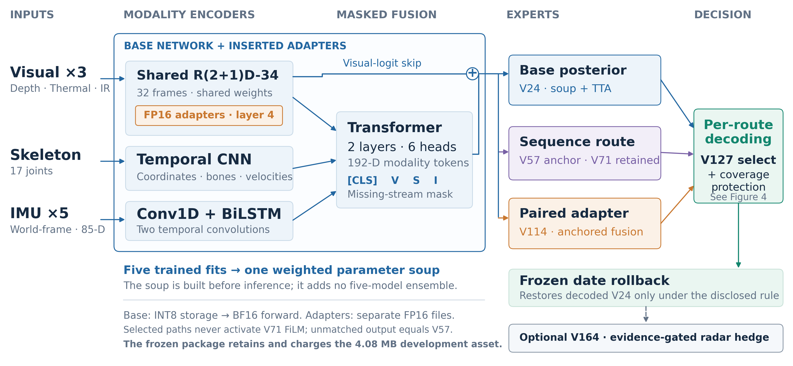

# Lazyshu: From 53.94% to Fourth on the CUHK-X Private Leaderboard

[中文](README.md) · [Kaggle final leaderboard](https://www.kaggle.com/competitions/cuhk-x-competition-small-model-track/leaderboard) · [Technical report](docs/technical_report.pdf) · [Full version history](docs/RESEARCH_LINEAGE_zh-CN.md)

Lazyshu is our solution to the **CUHK-X Small Model Track**. The main development period ran from September 6 to September 15, with the decisive iterations concentrated in the final week.

We started from a `53.94%` multimodal baseline. The final primary submission achieved **91.176% private accuracy** and **fourth place on the Kaggle private leaderboard**. The team advanced to the UbiComp 2026 finals and received an **Outstanding Award**, using **84.09 MB** of runtime assets.



## How the System Grew

| Version | What changed | Development result |
|---|---|---:|
| V1 | First six-modality cross-subject baseline | 53.94% |
| V2 | Person crops, IR enhancement, world-frame IMU | 63.45% |
| V3 | Spatiotemporal video encoding | 70.52% |
| V24 | Full-data training, parameter soup, INT8, pseudo adaptation | 86.07% |
| V52/V57 | Compact logit and sequence distillation | 88.06% |
| V114/V127 | Paired-person adapters and supervision-aware routing | 88.80% |
| V164 | Neural-evidence-gated radar timing | 89.39% |
| V166 | 90.35% locally, but rejected after online regression | — |

Early progress came from fixing the input representation and temporal visual model. Later progress came from using supervision, adapters, and structural information more carefully.

Several larger or more complicated ideas improved local validation but failed online. The final submission was therefore not the locally highest-scoring system; it was the system we considered more reliable under distribution shift.

## Two Ways to Read This Repository

- **Final system only:** continue with this README, [`solution/`](solution/), and the [version cards](docs/VERSION_CARDS_zh-CN.md).
- **Full research process:** start from the [research archive guide](research_archive/INDEX_en.md), then explore the V1–V197 lineage, all retained experiment branches, and negative results.

Version numbers identify research batches, not 197 monotonic upgrades. The public tree retains `1,196` historical files and `178` experiment directories. The final inference entry point is in `solution/`; execution requires the unpublished frozen artifacts.

## Final System

- Shared R(2+1)D-34 for depth, thermal, and infrared video.
- Temporal CNN for skeleton and Conv1D + BiLSTM for IMU.
- Masked Transformer fusion after modality-specific encoding.
- Paired adapter when labeled same-person source data exist; decoded V57 otherwise.
- Radar points are not neural inputs; V164 uses only radar timing as a gated challenger.
- All runtime weights and states total `84,094,248 bytes`.

## Results

The public and private results can be checked on the [Kaggle final leaderboard](https://www.kaggle.com/competitions/cuhk-x-competition-small-model-track/leaderboard).

| Submission | Public | Private | Note |
|---|---:|---:|---|
| V127 | **0.92039** | **0.91176** | Primary, fourth on the Kaggle private leaderboard |
| V164 | 0.91044 | 0.90686 | Structural hedge |

Both CSV files were regenerated byte-for-byte from the original label-free test inputs in an internal audit of the private frozen bundle.

## Reproduction

This release publishes code, configurations, and research documentation only. **Model weights, decoder state, and final prediction CSVs are not published**, and no Hugging Face or ModelScope model repository is planned. The privately retained frozen bundle has SHA-256:

```text
SHA-256 060c126ac015135f5265d510ed6db6eaa799d515f22178fb6b12c2cbf28cc55a
```

The repository preserves the preprocessing, training method, architecture, routing, and decoding implementation. Final inference requires all 14 frozen artifacts, including model weights, the YOLO11n detector, and decoder state. There is no automatic artifact download; missing files or mismatched hashes stop inference.

After restoring the complete frozen artifacts matching `solution/configs/artifact_hashes.json` and obtaining authorized data, run from the repository root:

```bash
bash solution/inference.sh /path/to/testing/data /path/to/output.csv
```

For independent retraining, see the [training guide](solution/training/README.md). New checkpoints will not pass the frozen hash checks as-is; they require their own decoder state and artifact inventory. Competition data are not redistributed here. See the [reproduction notes](docs/REPRODUCIBILITY.md) for the release boundary.

## Repository

```text
solution/            Final inference, training snapshot, and verification code
research_archive/    V1–V197 lineage and all retained experiment records
docs/                Report, version history, negative results, and model notes
```

- [Complete research archive guide](research_archive/INDEX_en.md)
- [Full V1–V197 lineage](docs/RESEARCH_LINEAGE_zh-CN.md)
- [Negative results](docs/NEGATIVE_RESULTS.md)

## Attribution and Thanks

The project adopts established methods including R(2+1)D, Transformers, BiLSTMs, FiLM, adapters, MixUp, and model soups. It also uses the official baseline as a reference, public pretrained initialization, and YOLO11n. Our work lies in the task-specific validation, composition, adaptation, routing, compression, and reproduction.

We thank the CUHK-X organizers and CUHK AIoT Lab, SwanLab, the PyTrio team, and the PyTorch, TorchVision, Ultralytics, and research communities.

This project was developed collaboratively by Liu Zhaoyang and **GPT-5.6-sol**. Liu Zhaoyang led the competition entry, research objectives, compute resources, submission decisions, and final presentation; GPT-5.6-sol contributed to implementation, debugging, experiment orchestration, analysis, documentation, and review. See [Acknowledgements](ACKNOWLEDGEMENTS.md) and [Method Provenance](docs/METHOD_PROVENANCE.md).

## License

Original project code is Apache-2.0. Third-party software, models, and data retain their respective licenses; see `THIRD_PARTY_NOTICES.md`.

The [technical report](docs/technical_report.pdf) is licensed under CC BY 4.0, copyright © 2026 Liu Zhaoyang. See the [report license](docs/REPORT_LICENSE.md).
